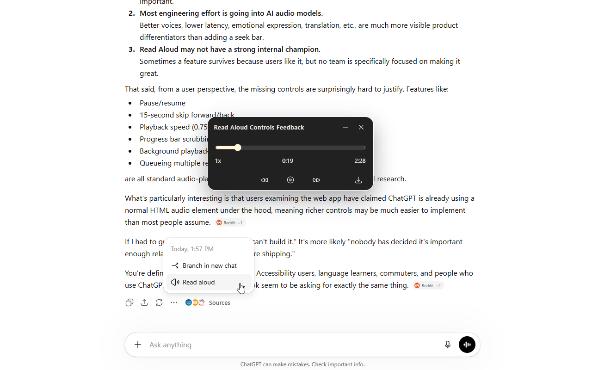

# Read Aloud Controls for ChatGPT

A browser extension that adds a floating control panel for ChatGPT Read Aloud. It provides playback controls, a seek bar, configurable skip intervals, speed control, theme settings, and audio download support when capture completes.

This project is not affiliated with OpenAI.



## Features

- Optional automatic Read Aloud for newly completed responses, with an independent queue in each tab.
- Attached reading queue with response previews, drag or arrow reordering, removal, clear, and Undo.
- Select another response's Read Aloud to queue it without interrupting current playback, even with automatic reading off.
- Floating player that appears when ChatGPT Read Aloud starts.
- Play and pause controls.
- Resumable first-Pause handoff to an extension-owned copy after capture is seek-ready.
- Configurable skip-back and skip-forward intervals.
- Stable timeline from native metadata or completed-capture metadata when ChatGPT streams an indefinite duration.
- Safe seeking and skip controls limited to the ranges ChatGPT has made seekable.
- Playback speeds: `0.75x`, `1x`, `1.25x`, `1.5x`, and `2x`.
- Current and total listening-time labels adjusted for the selected speed.
- Conversation-aware track title with long-title truncation.
- Download button for captured Read Aloud audio responses, enabled only after capture completes.
- Theme setting: follow system, light, or dark.
- Draggable, collapsible player.
- Close-to-pause behavior.
- Local preview harness for UI checks without a live ChatGPT audio stream.

## Install for local use

1. Download or clone this repository.
2. Open `chrome://extensions` in Chrome or another Chromium-based browser.
3. Enable **Developer mode**.
4. Select **Load unpacked**.
5. Choose this repository folder.
6. Reload any open `chatgpt.com` tabs.
7. Start ChatGPT Read Aloud.

The player appears automatically after ChatGPT starts a Read Aloud audio stream.

Pause is briefly unavailable while the extension prepares a seekable copy of the captured response. Once ready, the first Pause preserves the current position by transferring control to that copy before stopping ChatGPT's fragile page stream. The floating player then remains authoritative for Play, Pause, seek, skip, and speed; ChatGPT's native Read Aloud button may appear idle after this handoff.

The captured-playback repair was live-validated in the Chrome test profile and confirmed again after reloading the final build on October 7, 2026. See [`docs/LIVE_VALIDATION_2026-10-07.md`](docs/LIVE_VALIDATION_2026-10-07.md) for the exercised controls, automated checks, and remaining preview-only limitation.

## Popup settings

Open the extension icon to configure player settings:

- **Skip back seconds**: number of seconds moved by the back button. Fresh installs default to 15 seconds.
- **Skip forward seconds**: number of seconds moved by the forward button. Fresh installs default to 15 seconds.
- **Default playback speed**: the speed applied to active and future Read Aloud playback.
- **Theme**: follow system, light, or dark.

Settings are saved with `chrome.storage.local` and forwarded to active ChatGPT tabs by the extension settings bridge. Defaults, speed options, limits, and validation are defined only in `src/js/player-settings.js`; other scripts consume that shared settings contract rather than carrying duplicate defaults.

Check **Automatically read new responses aloud** to read completed replies without
pressing Read Aloud. The setting starts off and applies across ChatGPT tabs;
each tab keeps its own queue. Opening or focusing an existing conversation does
not narrate its history. Pause holds the queue, and closing the controller clears
that tab's waiting responses. Turning the setting off removes automatically
added entries while keeping your explicit selections and audio already playing.
Queues are discarded on navigation or reload.

Use the queue button beside Download to show the reading list. Its number counts
the current response plus waiting responses. Clicking a
preview scrolls to and briefly highlights its source message; it does not change
the playback order. Drag a row by its handle or use its arrow buttons to reorder.
Remove or clear upcoming responses and use Undo to restore valid entries. Minimize
hides the drawer and timeline together; expanding remembers the drawer's state.
Start failures appear in the drawer with Retry as well as in the popup status.
The queue stores response references and short snippets, and requests audio only
when a response reaches its turn. There is no audio prefetch or persistent history.

After updating the unpacked extension, reload it in Chrome's extension manager
and refresh the ChatGPT tabs where you want to use the new option. See
[`docs/AUTO_READ_ALOUD.md`](docs/AUTO_READ_ALOUD.md) for the runtime contract and
verification details.

Automatic reading can intermittently fail to start on some ChatGPT tabs. The
conditions are still being investigated; native Read Aloud remains the manual
fallback. This branch includes that known limitation.

## Download behavior

The download button stays visible but disabled while audio capture is still loading. It enables only when the active Read Aloud response has fully completed capture. This avoids accidental partial downloads. Starting a download does not change the icon; Chrome's own download UI provides confirmation while the player keeps the control stable and repeatable.

The downloaded file is built from the audio response captured while ChatGPT is streaming Read Aloud audio. The extension does not depend on re-fetching the audio element source after playback.

## Local preview

Open `preview.html` directly in a browser to check the injected player UI without loading ChatGPT.

The preview exercises layout, theme, time labels, speed, and download states. It does not simulate completion of the detached captured-player readiness lifecycle, so its Play/Pause control can remain in `Preparing resumable playback`. Use a live ChatGPT Read Aloud response for pause/resume validation.

For an interactive local queue preview, serve the repository and open
`tests/fixtures/reading-queue-preview.html`. It runs the actual player and queue
against a local synthetic service boundary with silent WAV media. The UI checks
are in `tests/fixtures/reading-queue.html`; native-click and queue integration
checks are in `tests/fixtures/auto-read-runtime.html`. Keyboard focus and compact
player regressions are in `tests/fixtures/quiet-player.html`. These do not replace live
ChatGPT extension validation.

Useful query parameters:

```text
preview.html?ae-theme=dark&ae-duration=420&ae-current=80&ae-rate=2&ae-back=10&ae-forward=15&ae-download=ready
```

Supported preview parameters:

- `ae-theme=light|dark`
- `ae-duration=<seconds>`
- `ae-current=<seconds>`
- `ae-rate=<supported speed>`
- `ae-back=<seconds>`
- `ae-forward=<seconds>`
- `ae-download=loading|ready|failed`

## Development notes

The extension intentionally uses plain Manifest V3 HTML, CSS, and JavaScript. There is no bundler or package manager.

Important runtime files:

```text
manifest.json             Chrome extension manifest
src/js/content-script.js  Main-world player, audio tracking, fetch capture, and UI
src/js/media-timeline.js  Stable duration, seek-range, and metadata-probe helpers
src/js/captured-playback.js Detached captured-player readiness and cleanup lifecycle
src/js/player-settings.js Shared settings schema, defaults, and validation
src/js/settings-bridge.js Isolated-world storage bridge
src/js/popup.js           Popup settings controller
src/popup.html            Extension popup markup
src/css/popup.css         Popup styling
preview.html              Local UI preview harness
docs/                     Maintainer notes
```

See [`docs/CODEBASE.md`](docs/CODEBASE.md) for the file-level guide and [`docs/ARCHITECTURE.md`](docs/ARCHITECTURE.md) for runtime-boundary notes.

## Debugging

Runtime logs are disabled by default. To enable scoped player logs in the current ChatGPT tab:

```js
localStorage.setItem('ae_debug', '1')
```

To disable them:

```js
localStorage.removeItem('ae_debug')
```

Debug output uses the `[AE Player]` prefix.

## Contributing

Contributions should preserve the extension's runtime boundaries:

- Popup code may use extension APIs.
- `settings-bridge.js` may use extension APIs and forwards raw settings through scoped DOM `CustomEvent`s.
- `content-script.js` runs in the page's main world and must remain able to observe page-created audio elements and wrap `window.fetch`.
- Do not use `window.postMessage` for internal extension settings traffic.
- Avoid broad refactors of audio detection, fetch interception, or element tracking unless tied to a specific defect.

Before opening a pull request:

Use Node.js 18 or newer for the runtime tests (the harness relies on the built-in `Blob` implementation).

1. Run `node --test tests/*.test.js`.
2. Run JavaScript syntax checks for every file in `src/js/`.
3. Parse `manifest.json`.
4. Open `preview.html` in light and dark modes.
5. Test `ae-download=loading`, `ae-download=ready`, and `ae-download=failed` in preview mode.
6. Load the extension unpacked in Chrome.
7. Reload a fresh `chatgpt.com` tab.
8. Start Read Aloud and confirm the player appears.
9. Confirm a streamed response gains a stable timeline after capture completes, with seeks clamped to loaded ranges.
10. Let the timeline advance to a nonzero position, Pause without scrubbing, wait for UI sync, and confirm the bar and both skip buttons remain enabled at that position.
11. Resume and confirm playback advances from the preserved position rather than restarting or becoming inert.
12. Scrub to another loaded position and repeat Pause/Resume and both skip actions.
13. Confirm speed changes update both time labels without changing the seekbar position.
14. Start another Read Aloud response and confirm the previous captured player stops without pausing unrelated page audio.
15. Confirm the speed menu hover and selected states are stable.
16. Confirm the download button stays disabled until capture completes and returns to its non-hover resting state after downloading.
17. Confirm DevTools is not flooded with extension-origin messages or interrupted-play errors.

## Attribution

Originally forked from Ian Speckart's `chatgpt-audio-player`. This version has diverged into a settings-driven floating controls extension. See [`CREDITS.md`](CREDITS.md) for original project and third-party attributions.

## License

MIT. See [`LICENSE`](LICENSE).
