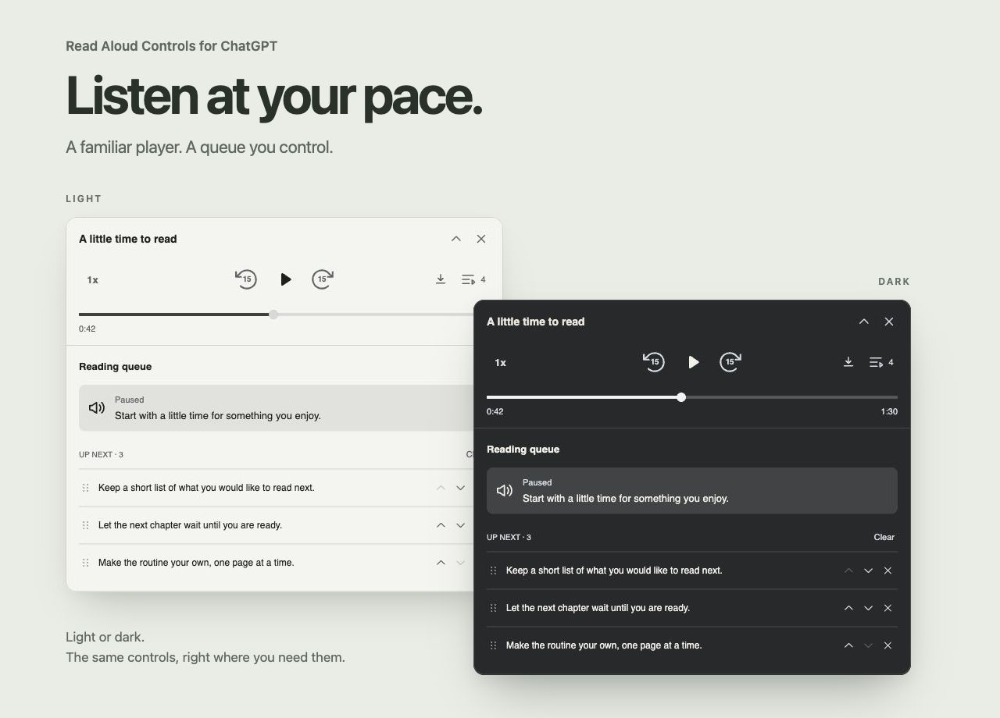
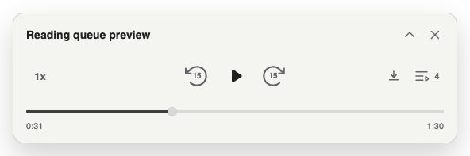
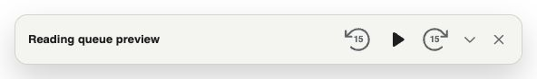
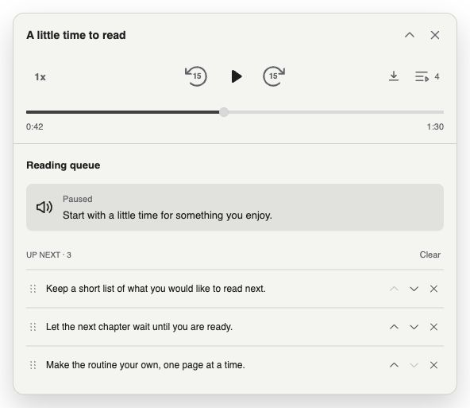
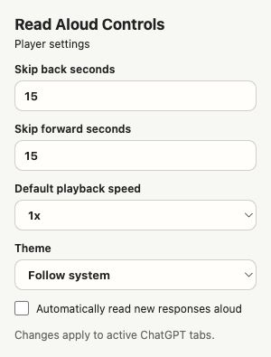

# Read Aloud Controls for ChatGPT

Listen to ChatGPT with a floating player and a reading queue you can manage. Pause and resume, seek through a response, change speed, and line up what to hear next.

<picture>
  <source media="(prefers-color-scheme: dark)" srcset="images/splash-dark.jpg">
  
</picture>

*Actual extension UI with sample responses. Screenshots follow your GitHub theme; the splash presents both options together. [Capture notes](images/README.md).*

This extension is independently maintained and is not affiliated with OpenAI.

## What it does

- **Manage your listening queue.** Select another response’s Read Aloud to add it without interrupting playback. Reorder by dragging or using arrows, remove entries, clear upcoming responses, and Undo a removal.
- **Read new responses automatically.** An optional setting adds newly completed responses to the queue. Each tab has its own queue; opening old conversations does not start narration.
- **Control playback.** Play, pause, seek, and skip backward or forward with independently configurable intervals from 1–300 seconds.
- **Choose your pace.** Use 0.75×, 1×, 1.25×, 1.5×, or 2× speed. Both time labels reflect listening time at the selected speed.
- **Keep the player small.** Drag it out of the way or minimize it. The same playback controls stay available, and expanding restores the drawer’s previous state.
- **Download completed audio.** The download button enables once the response has finished capturing.
- **Choose a theme.** Follow the system appearance or select light or dark.

## Install or update

1. [Download the repository ZIP](https://github.com/Tiffufu/chatgpt-read-aloud-controls/archive/refs/heads/main.zip) and extract it, or clone this repository.
2. Open `chrome://extensions` in Chrome or another Chromium-based browser.
3. Enable **Developer mode**, select **Load unpacked**, and choose the extracted repository folder containing `manifest.json`.
4. Refresh open `chatgpt.com` tabs.
5. Start **Read Aloud** on a ChatGPT response. The player appears automatically.

When updating an existing unpacked installation, update its files, click **Reload** on the extension card, and refresh ChatGPT. Tabs left open across an extension reload need refreshing to use the new scripts.

## The player

With the drawer closed, the player keeps the playback controls and timeline in view:

<picture>
  <source media="(prefers-color-scheme: dark)" srcset="images/player-expanded-dark.jpg">
  
</picture>

Minimizing hides the timeline and drawer while keeping the same skip intervals and Play/Pause control:

<picture>
  <source media="(prefers-color-scheme: dark)" srcset="images/player-minimized-dark.jpg">
  
</picture>

## The reading queue

Open the queue beside Download to see the current response and what is waiting. **The button counts the current response plus waiting responses**: `4` means one current response and three waiting. The drawer labels only those three as **Up next**.

Clicking a response preview scrolls to and briefly highlights its source in the chat. It does not start playback or change the order. Pause holds your place; new responses can still join the end.

<picture>
  <source media="(prefers-color-scheme: dark)" srcset="images/reading-queue-dark.jpg">
  
</picture>

Queues stay in memory separately in each tab. They store response references and short excerpts, without prefetching queued audio. Closing the player clears the queue; changing conversations or reloading discards pending entries. Turning automatic reading off removes automatic entries while preserving your explicit selections and current audio.

See the [usage guide](docs/USAGE.md) for queue controls, settings, downloads, and recovery.

## Settings

Open the extension icon to set skip intervals, default speed, theme, and **Automatically read new responses aloud**. Automatic reading starts off; both skip intervals default to 15 seconds. Settings are saved locally and apply to active ChatGPT tabs.

<picture>
  <source media="(prefers-color-scheme: dark)" srcset="images/settings-dark.jpg">
  
</picture>

## Privacy

Settings are stored locally. Each tab keeps its queue and captured audio in memory;
the extension has no developer-operated server or analytics. See the
[privacy statement](PRIVACY.md) for page access, storage, downloads, and controls.

## Playback notes

Pause becomes available after the captured response is ready for resumable playback. The first Pause transfers control to that copy at the current position; use the floating player afterward, since ChatGPT’s native indicator may appear idle.

Seeking and skipping are limited to available audio ranges. Download stays disabled until capture completes. If automatic playback fails, check the drawer or popup for an error and try **Retry** or start native Read Aloud manually. ChatGPT site changes can affect response detection and playback; see [troubleshooting](docs/USAGE.md#troubleshooting).

## Development and documentation

The extension uses plain Manifest V3 HTML, CSS, and JavaScript. There is no build step, runtime framework, or package installation. Its only extension permission is `storage`.

- [Usage and troubleshooting](docs/USAGE.md)
- [Privacy](PRIVACY.md)
- [Changelog](CHANGELOG.md)
- [Recorded validation and limits](docs/VALIDATION.md)
- [Development, previews, and verification](docs/DEVELOPMENT.md)
- [Codebase guide](docs/CODEBASE.md)
- [Architecture and compatibility boundaries](docs/ARCHITECTURE.md)
- [Automatic reading and queue contract](docs/AUTO_READ_ALOUD.md)
- [Screenshot sources and refresh instructions](images/README.md)

## Attribution and license

Originally forked from [Ian Speckart’s Audio Player for ChatGPT](https://github.com/ian-speckart/chatgpt-audio-player). The player, queue, settings, and playback handling have since changed substantially. See [CREDITS.md](CREDITS.md) for the original project and contributors, and [THIRD_PARTY_NOTICES.md](THIRD_PARTY_NOTICES.md) for included icon notices.

MIT. See [LICENSE](LICENSE).
