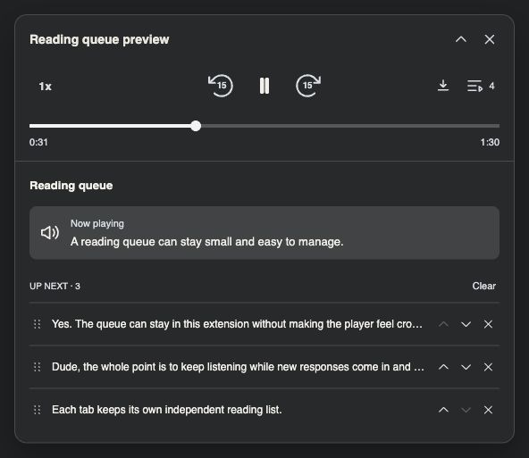
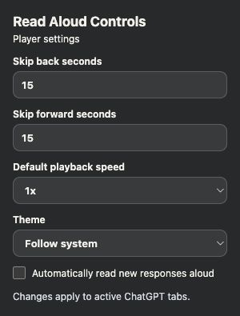

# Using Read Aloud Controls

## Start listening

Start **Read Aloud** on a completed ChatGPT response. The floating player appears when playback starts. Drag its header to reposition it.

| Control | What it does |
| --- | --- |
| Back / forward | Skip by the seconds shown inside each icon. Configure each interval separately in the popup. |
| Play / Pause | Control the current response. Pause holds the queue. |
| Speed | Choose 0.75×, 1×, 1.25×, 1.5×, or 2×. |
| Timeline | Seek within the audio ranges currently available. Time labels adjust for speed. |
| Download | Save the current captured audio after capture completes. |
| Queue | Show or hide the attached reading drawer. |
| Collapse / expand | Hide or show the timeline and drawer. |
| Close | Pause the current audio, close the player, and clear this tab’s queue. |

The player briefly disables Pause while preparing a resumable copy of the response. On the first enabled Pause, it transfers playback to that copy at the current position. ChatGPT’s own Read Aloud indicator can appear idle afterward; continue using the floating player.

## Build and manage a queue

While one response is playing or paused, select **Read Aloud** on another completed response. It joins the end instead of interrupting playback. This also works when automatic reading is off.

The queue button counts **current + waiting**. In this screenshot its `4` means one current response and three waiting; **Up next · 3** refers only to those waiting. A current response still counts while paused. A finished response does not count.

| Action | Result |
| --- | --- |
| Click a response excerpt | Scroll to and briefly highlight its source in the chat, without playing it. |
| Drag the dotted handle | Move an upcoming response to another position. |
| Use the up/down arrows | Reorder without dragging, including with the keyboard. |
| Remove an entry | Remove that upcoming response. |
| Clear | Remove all upcoming responses while leaving the current one alone. |
| Undo | Restore the most recent removal or clear, if those responses are still valid in the same conversation. |

Selecting an already queued response does not add a duplicate. Excerpts use a meaningful opening sentence when it fits; very short openings can include more context, and longer text is shortened with an ellipsis.

### Pause, minimize, and advance

Pausing holds your position and prevents the next response from starting. New responses can still join the queue. Playback advances when the current audio ends, keeping the player mounted while the next response starts.

Minimizing hides the timeline, extra controls, and drawer. Expanding remembers whether the drawer was open. It does not change the skip intervals or playback position.

### Queue lifetime and memory

Each tab has an independent queue. Queued entries contain references and short text excerpts; the extension requests their audio only when it is their turn. Managing the queue does not retain a separate audio recording for every waiting response.

The current response’s captured audio uses memory for playback and download. Closing or replacing that response releases its captured playback resources. Queues are temporary: closing the player, leaving the conversation, reloading the page, or invalidating the extension clears pending work. A queue is not saved listening history.

## Enable automatic reading

Open the extension popup and check **Automatically read new responses aloud**.

Newly completed responses join the tab’s queue. Opening, scrolling, or focusing an existing conversation does not read its history. Both manually selected and automatically added responses wait behind paused playback.

Turning the setting off removes automatically added entries while preserving your explicit selections and current playback. The setting applies across ChatGPT tabs; their queues remain independent.

Settings are stored in `chrome.storage.local`. Fresh installs use 15-second skips, 1× speed, system theme, and automatic reading off. Skip intervals can be set independently from 1–300 seconds.

## Download audio

Download stays visible but disabled until the response has finished capturing. It saves the captured response, without requesting the audio again. The downloaded file keeps the original captured format. Chrome’s download UI provides confirmation; the player’s icon stays in place.

Capture completion does not mean playback has ended. Download can become available while you are still listening.

## Troubleshooting

### The player does not appear after an update

Reload the extension in `chrome://extensions`, then refresh the ChatGPT tab. An already open tab may still contain scripts from the previous extension version. Start native Read Aloud again.

### A queued response does not start

Read the error in the drawer or extension popup. Use **Retry** when available, or start native Read Aloud manually. An unavailable native button or missing playback confirmation suspends the queue after 15 seconds. Browser autoplay rules, network errors, or ChatGPT site changes can also prevent a start.

Intermittent automatic-start failures have been reported. If a failure persists, note whether the tab was refreshed after an extension update, whether it was in the background, and the error shown. Avoid including private conversation content in reports.

### Pause or seeking is temporarily unavailable

Wait for capture and resumable playback preparation. Seeking and skipping stay within available ranges; an unavailable tail of a response cannot be reached yet. A preparation failure leaves ChatGPT’s original playback in place.

### A response preview no longer opens its source

The source may have been removed, edited, or unloaded by ChatGPT. The drawer reports that it is unavailable. Queue recovery does not recreate missing chat content.

## About the screenshots

These are browser captures of the production extension modules with local sample responses and silent audio. The popup image uses its actual HTML, CSS, and JavaScript with default settings. They show the current implementation, without publishing private ChatGPT conversations. See [capture instructions](../images/README.md).
